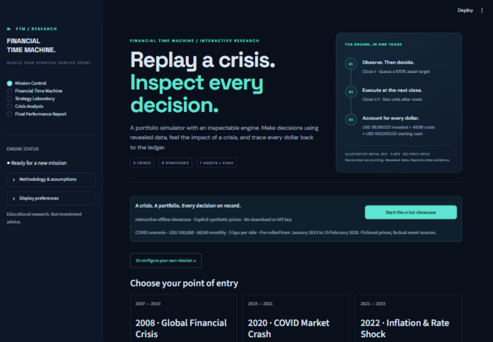
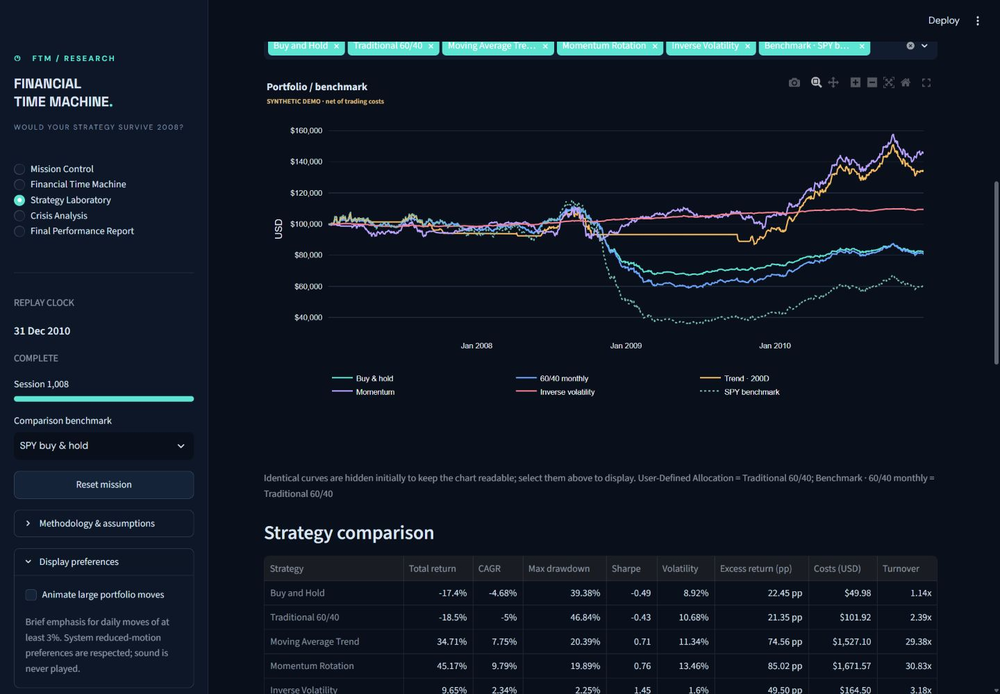
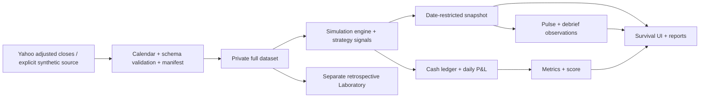

# FINANCIAL TIME MACHINE

### Would Your Strategy Survive 2008?

A causal historical portfolio simulator and quantitative research laboratory. Enter a crisis with $100,000, observe one close at a time, submit next-session investment decisions, and measure what survived.

Built to make financial engineering inspectable: every allocation has a signal date, every execution has a cash ledger, and every performance number comes from the shared accounting engine.

The central engineering question is **“Can you explain and reproduce this number?”** The replay pairs next-session execution with a revealed-data boundary, an inspectable ledger, computed reconciliation checks, and a downloadable run passport. The same accounting code powers the interactive experience and the research laboratory.

## Try it in three minutes

1. Run the app, then select **Start the crisis showcase** on Mission Control. It uses explicitly labeled synthetic prices, USD 100,000, 5 bps per side, and monthly 60/40 SPY/AGG allocation. The replay is already advanced to **19 February 2020**; an existing active replay is offered for resumption instead of being overwritten.
2. Advance to the **next month-end**. The engine processes every intervening session through **31 March 2020**. Inspect the portfolio pulse, allocation, and pending order. Synthetic moves illustrate the interaction; they are not historical COVID returns.
3. Open **Replay integrity**. Follow the latest close from holdings and costs to the equity change, then select **Run corruption drill**. Three separate copied snapshots receive deliberate cash, future-date, and P&L faults; inspect which checks detect them and confirm that the original snapshot is unchanged. Download the run passport JSON to connect the visual result to its numerical and data provenance.
4. Open the interim report, then the separate retrospective Laboratory if time permits. Report exports stop at the replay clock; Laboratory deliberately evaluates the complete scenario.

Full setup, methodology, and a manual scenario walkthrough follow below.

## The experience

| Workspace | What it does |
|---|---|
| Mission Control | Select a scenario, genuine historical data or an explicit synthetic demo, capital, costs, and a strategy. Review eligibility before launching. |
| Financial Time Machine | Advance one session, five sessions, or to next calendar month-end; queue/cancel allocations, keep a dated decision journal, and review holdings, portfolio pulses, and disclosed events. |
| Strategy Laboratory | Independently compare all six strategies over the same historical window; filter displayed curves and inspect the full results table. This workspace is explicitly retrospective research. |
| Crisis Analysis | After replay completion: drawdowns, rolling volatility/correlations, empirical tail risk, crisis-window comparisons, and P&L/risk attribution. |
| Final Performance Report | Partial reports use revealed observations only; completed reports add the transparent survival score. Review a computed three-observation debrief and download equity, trade, decision CSVs, or self-contained HTML. |

Three scenarios are available: **2007–2010 financial crisis**, **2019–2021 COVID crash**, and **2021–2023 inflation/rate shock**. The supported universe is SPY, QQQ, AGG, IEF, TLT, GLD, SHY, and cash, subject to inception and full-window price validation.

The replay adds context without manufacturing drama. A **portfolio pulse** identifies the largest daily account move among newly revealed sessions, including a move crossed during a weekly or monthly advance. Moves of at least ±3% receive a brief, restrained visual emphasis. The sidebar's **Display preferences** can disable animation, and system reduced-motion preferences are respected. A **decision journal** records reasoning before later closes reveal the result; observations can also be saved without trading. The report debrief identifies the toughest session, deepest drawdown/recovery, and the recorded cash/cost/benchmark tradeoff. All observations come from actual simulation history. See [experience and motion rules](docs/EXPERIENCE.md).

Screenshots in `docs/screenshots/` are captured from the running application. Any demonstration results shown there use visibly labeled synthetic prices; they are not historical performance.

Every app chart includes **SYNTHETIC DEMO** or **HISTORICAL DATA** inside the figure, so the source label remains in native PNG downloads. Use the report's labeled HTML, replay, trade-ledger, and decision-history export buttons, or Laboratory's comparison CSV; the data grid's raw CSV shortcut is hidden. Laboratory exports are rectangular CSV files with source, retrospective research mode, scenario, benchmark, and evaluation dates on each row, while metric columns remain numeric. HTML provenance also records the strategy and its parameters. Formula-like journal text receives an apostrophe prefix in CSV so spreadsheet applications treat it as literal text; financial numeric columns and the original escaped HTML note are unchanged.





## Run on Windows

Use **Python 3.12** (the local validation environment is CPython 3.12.14). Python 3.13 is also included in the configured CI matrix; that remote job must run before claiming CI verification.

```powershell
cd "C:\path\to\financial-time-machine"
python -m venv .venv
.\.venv\Scripts\Activate.ps1
python -m pip install -r requirements.txt
python -m streamlit run app.py
```

Activation is optional: use `.\.venv\Scripts\python.exe` instead of `python` if PowerShell blocks activation. No API key, paid subscription, database, or account is needed for the offline demonstration. Genuine downloads require internet access and a functioning provider.

Windows convenience launcher: `powershell -ExecutionPolicy Bypass -File .\run.ps1` creates a local environment, installs requirements, and starts the app. It also recognizes the bundled Codex Python runtime if the Windows `python` alias is broken. Add `-Check` to run the offline tests instead of launching.

The entrypoint is **`app.py` in the repository root**. The dependency file is **`requirements.txt` in the repository root**.

Both Mission Control and Laboratory support starting capital from **USD 1,000 to USD 1 billion**, with execution costs from **0 to 100 bps per side**. Blank numeric entries restore their configured defaults. Invalid allocations are explained before execution.

## A 2008 walkthrough

1. In Mission Control, select the financial-crisis scenario, $100,000, and 5 bps per side.
2. Select historical data, or explicitly choose the synthetic demonstration for an offline tour. Initialize, review the scenario, capital, costs, rule, eligible assets, and provenance, then launch. Changing these settings invalidates the previous preflight and requires initialization again.
3. The replay begins at the first actual exchange close: January 3, 2007. January 1 was a holiday and January 2 an exceptional exchange closure.
4. Your initial balance is cash. The chosen starting allocation is pending for the next close. Advance one day to execute it; the holdings do not earn the return preceding their execution.
5. Queue target weights totaling 100%, cancel a pending order, or move toward cash. A manual submission visibly replaces the single pending automatic target. Draft weights survive page changes within this browser session; a fresh mission clears them.
6. Optionally write a decision-journal note before queuing the target, or choose **Save observation without trading**. The latter records your thinking at the current close without altering the pending order, holdings, or clock.
7. Advance five sessions or to next month-end. Every intervening session processes prices, costs, orders, and automatic strategy signals. The portfolio pulse highlights the largest newly revealed daily move; its direction does not describe the net return of the entire advance.
8. Read only announcements disclosed by the replay clock. Choose SPY or the eligible monthly 60/40 comparison benchmark in the sidebar. Open interim reports and download the decision journal without exposing future prices.
9. Finish the scenario to unlock crisis analytics and the final educational score. Review the debrief and compare the outcome with the explicitly named benchmark.

Scenario names deliberately disclose historical context. This is educational replay, not a blind forecasting experiment.

## Six investment rules

| Strategy | Default rule |
|---|---|
| Buy and Hold | Submit the selected allocation at the first close; execute next close and hold. |
| Traditional 60/40 | 60% SPY / 40% AGG; monthly end-of-period signals, next-session close execution. Excluded if either asset is unavailable. |
| Moving Average Trend | Daily: SPY above its trailing 200-close mean targets 100% SPY; otherwise cash. Insufficient warm-up remains cash. |
| Momentum Rotation | Monthly: trailing 126-session returns; top one positive asset; alphabetical ticker tie-break; no positive eligible asset means cash. Lookback is configurable. |
| Inverse Volatility | Monthly inverse sample volatility over 63 daily returns. Exclude insufficient/zero-volatility estimates; apply per-asset caps without renormalizing above them; residual cash. |
| User-Defined Allocation | Custom weights; none/monthly/quarterly/annual rebalancing. |

In Laboratory, the allocation inside **Custom allocation and rebalancing** applies to both Buy and Hold and User-Defined Allocation; the other four rules determine their own targets. The displayed run summary records those settings. Curves with identical recorded equity are hidden initially to avoid duplicate lines, but remain available in **Display on chart** and the comparison table.

SHY is an ETF with market risk and transaction costs; it is not cash. Cash earns **0%**. The separate risk-free assumption for performance ratios defaults to **0%** because a vintage-appropriate rate series is not supplied.

## Accounting and execution

All portfolios are in USD, long only, unleveraged, with fractional synthetic adjusted-close units. There are no taxes, external flows, fixed commissions, or automatic terminal liquidation.

At each close, old holdings earn the move into that close. Pending orders then execute at that close and pay costs; the engine records cash, holdings, equity, and return; finally, the newly revealed information may generate a later order. Starting capital is recorded as cash at the initial close for both portfolios and benchmarks.

Orders are **target weights**, sized at the execution close against **post-cost equity**. A deterministic bisection solves the feasible target; sells fund buys, and residual cash absorbs rounding. Weights must be finite, nonnegative, and sum to 100% within absolute tolerance `1e-8`.

`cost = cost_bps / 10,000 × sum(abs(units_traded × execution_price))`

Both purchases and sales pay this single per-side cost. There is no additional hidden slippage charge. The ledger exposes signal/execution dates, order identifiers, signed units and notional, price, gross notional, costs, and cash after each fill. Daily equity and asset/cash/cost P&L reconcile. Orders without a remaining execution session are canceled and reported.

**Adjusted closes are not executable historical quotes.** They approximate reinvested total returns. Dividends and splits are not separately credited. Retrospective corporate-action adjustments and provider revisions mean these data are not a fully point-in-time database.

See [financial methodology](docs/METHODOLOGY.md) for formulas, edge cases, score weights, and the preservation-versus-growth tradeoff.

## Data, provenance, and honest failure

The genuine pipeline requests explicit `Adj Close` data using [yfinance](https://ranaroussi.github.io/yfinance/reference/api/yfinance.download.html), with `auto_adjust=False`, `actions=False`, `repair=False`, `keepna=True`, and daily interval. It retrieves trailing warm-up history and validates against the **XNYS exchange calendar**, including exceptional closures.

The manifest records tickers, source, retrieval timestamp, requested/observed dates, adjustment settings, warnings, exclusions, and a content fingerprint. Dates are not silently dropped and prices are never forward/back-filled. Assets without complete scenario observations are excluded before the fixed run universe is accepted. A held asset cannot be valued using a stale or invented close. Unusual moves are flagged, not removed.

Downloads and expensive transformations are cached. On provider failure, the loader can use an exact validated genuine local cache with its original provenance. Otherwise it shows an error; the user can separately select the deterministic **SYNTHETIC DEMONSTRATION**. Genuine and synthetic observations are never mixed. Cache contents are ignored by Git; no genuine price observations are bundled or redistributed. [yfinance's data-use notice](https://github.com/ranaroussi/yfinance) and the original providers' terms govern downloaded data; the software license does not confer data rights.

The factual event catalog contains primary-source URLs from the Federal Reserve, SEC, and WHO. Known publication times are compared against America/New_York exchange close; after-close/weekend events appear next session. Unknown times conservatively disclose next session after publication date. No fictional news is generated. Macroeconomic indicators are deliberately omitted because reliable release-vintage integration is not implemented.

## Architecture



The reusable `core/` engine imports no Streamlit code. Strategies receive a trailing frame restricted to the signal date. Survival presentation consumes copied snapshots, including restricted prices, benchmark histories, decisions, and contributions. Pure experience helpers derive pulses and debrief observations from those recorded frames. The UI attaches dated journal notes to a copy of the decision log; notes do not enter strategy signals or accounting. Reports independently enforce the as-of boundary and recompute metrics from restricted history. Laboratory results and replay state have separate session keys; page changes and reruns do not advance the clock or duplicate executions. Each browser session owns its own simulation objects.

```text
financial-time-machine/
├── app.py
├── requirements.txt
├── README.md
├── LICENSE
├── core/
│   ├── data_loader.py
│   ├── portfolio.py
│   ├── backtest_engine.py
│   ├── strategies.py
│   ├── metrics.py
│   ├── scenarios.py
│   ├── event_timeline.py
│   ├── experience.py
│   └── reporting.py
├── ui/
│   ├── charts.py
│   ├── components.py      # factual pulse and debrief presentation
│   └── styling.py
├── data/events/           # sourced historical announcements
├── tests/                 # deterministic numerical, leakage, state, and UI tests
├── docs/                  # methodology, architecture, screenshots, acceptance evidence
├── .streamlit/config.toml
└── .github/workflows/tests.yml
```

## Verification

```powershell
python -m pytest -q
```

The default suite is deterministic and offline. It covers hand-calculated costs and returns, cash reconciliation, invalid weights, missing prices/inception, period-end orders, intermediate sessions, future-price perturbations, delayed return earning, benchmark windows, event disclosure, restricted exports, score monotonicity, stale preflight invalidation, Streamlit reruns/navigation/reset, all six strategy types, and restricted pulse/debrief calculations. Exact final check results belong to the acceptance record below.

Optional live-provider integration is separate:

```powershell
$env:FTM_INTEGRATION = "1"
python -m pytest -q -m integration
Remove-Item Env:FTM_INTEGRATION
```

GitHub Actions is configured for push and pull requests. A local passing suite is distinct from a completed GitHub Actions run. See [acceptance evidence](docs/ACCEPTANCE.md) for observed commands/results and limits of verification.

The final reliability suite includes every scenario/strategy lifecycle through reports and a fresh attempt, all-cash completion at every custom frequency, saved/reopened widget attachment bytes, extreme supported inputs, corrupt-cache recovery, and literal CSV journal text. See `docs/ACCEPTANCE.md` for exact observed results and browser-verification limits.

## Publish with GitHub Desktop

The local repository is named `financial-time-machine`, on `main`. Review the changed files in GitHub Desktop, commit the project files with a message such as `Build causal historical portfolio simulator`, then select **Publish repository** (or Push origin if you have already connected a remote). Review visibility and data terms before making it public. The development session does not automatically commit, push, merge, or deploy.

A review-ready PR title/body is in [docs/PULL_REQUEST.md](docs/PULL_REQUEST.md), for use if you choose a branch-and-PR workflow.

## Streamlit Community Cloud

Follow the [official deployment guide](https://docs.streamlit.io/deploy/streamlit-community-cloud/deploy-your-app/deploy): connect your GitHub repository, select **`main`**, set **Main file path: `app.py`**, and choose **Python 3.12** in Advanced settings. The app installs dependencies from root `requirements.txt`. No secrets are required. Provider access and availability remain external dependencies; select the explicit demo for offline review.

The project is prepared for this deployment workflow. A live hosted deployment is not claimed unless recorded in the acceptance evidence.

## Limitations and roadmap

Survivorship bias comes from using today's ETF universe. Prices may be retrospectively adjusted/revised; close-to-next-close execution is a simplified convention without intraday liquidity, bid/ask spreads, limit orders, market impact, or actual dividend tax handling. Transaction bps are an assumption, not calibrated execution estimates. Sample tail-risk and annualized short-window statistics are descriptive and unstable. Historical crisis windows do not predict future losses. Provider outages, rate limits, and data rights may constrain genuine downloads. The source package contains no genuine market observations. Replay snapshots, drafts, and journal notes are ephemeral browser-session state, not a persistent account: download reports before resetting or restarting the server. A local price cache does not restore portfolio state.

Future work: licensed point-in-time prices; ALFRED release-vintage macro data; persistent replay snapshots; richer order modeling; optional PDF reports; separately labeled Monte Carlo stress tests. These are not current features.

**Financial education disclaimer:** This software is an educational research tool, not investment advice, a recommendation, or an institutional risk rating. Past and synthetic performance do not predict future results.
