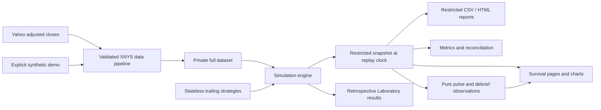

# Architecture and causality

The application has one root Streamlit entrypoint, `app.py`. Both the interactive
Survival replay and retrospective Strategy Laboratory use the same Python
`Simulation` engine. The engine has no Streamlit imports, widget dependencies,
provider calls, or presentation side effects.



## Boundaries

`core/data_loader.py` handles normalization, exchange-session validation, eligibility,
provider provenance, local caching, and deterministic synthetic demonstration data.
It does not silently replace genuine observations with invented values. The engine
receives one fixed eligible universe and an explicit scenario interval. Every
scenario session must have a positive finite close for each eligible asset. Missing
observations fail validation; no prices are forward- or backward-filled. Missing
warm-up observations remain missing and prevent indicator eligibility.
Exchange calendars are requested for an explicit bounded scenario window rather
than relying on the calendar library's date-relative default range.

`core/strategies.py` contains six stateless allocation rules. Each decision receives
only a copied price frame through the signal date. The replay clock and holdings
do not live inside a strategy. Parameter changes in Laboratory do not mutate a
Survival engine.

`core/backtest_engine.py` owns the full server-side price frame privately. Its
`snapshot()` and `result()` methods copy only revealed prices, recorded holdings,
cash, decisions, executions, and contributions. The application renders these
restricted frames, rather than sending the full dataset to a browser and hiding
future points. Pending orders identify their next execution session, but do not
contain future prices. Scenario names and advance destinations disclose calendar
context; this is an educational replay, not a blind historical prediction test.

`core/event_timeline.py` applies publication/disclosure timing independently of
asset prices. Events become visible only at an eligible exchange close. Source URLs
and conservative disclosure rules are retained with curated factual events.

`core/metrics.py` and `core/reporting.py` work on explicit passed-in frames. Reports
also enforce their cutoff independently. Full-period Crisis Analysis and the final
score are gated until the replay is complete. Interim downloads describe only the
matching elapsed period.

`core/experience.py` is a pure calculation layer over revealed account history.
It derives the strongest newly processed daily move and a drawdown/cash/cost
debrief. It restricts observations before calculation and never fetches prices,
generates historical news, chooses an allocation, or changes the clock.
`ui/components.py` formats those dictionaries and applies optional bounded CSS
motion; financial values remain readable with motion disabled.

## One session, in order

1. At the first scenario close, record the starting capital as cash. Queue the
   initial strategy target for the next eligible close. Warm-up prices support
   indicators but do not enter the performance baseline.
2. At each later close, existing units earn the change from the preceding close.
3. Execute the prior close's pending target at the current adjusted close. Fractional
   units are sized at this execution close using post-cost equity. Sell first, then
   buy, charging the configured cost on each side.
4. Record cash, equity, holdings, weights, daily returns, costs, gross traded
   notional, and dollar P&L contributions.
5. Reveal that close's information and, if due, generate a target for a later close.

Daily, weekly, and monthly advances all invoke this process for every intervening
session. A week is five sessions. A month advance ends on the final session of the
next calendar month, capped at scenario end. Remaining positions are valued at the
end without invented liquidation. A target without a remaining execution session
is canceled and logged.

## Cost-aware sizing

For pre-trade equity `V`, current asset values `v_i`, target asset weights `w_i`,
and per-side cost rate `c = cost_bps / 10,000`, solve:

```text
E + c × Σ |w_i × E − v_i| = V
```

`E` is post-cost equity. The monotone equation is solved deterministically by
bisection. Trades target `w_i × E` for each asset; cash receives its requested
weight and any numerical residual. Sells fund purchases and their costs. All
weights, including cash, must sum to 100% within an absolute tolerance of `1e-8`;
nonfinite and negative weights are rejected. No borrowing, leverage, short sales,
external flows, taxes, or cash interest are modeled. SHY is a traded asset.

For each ledger row, the engine records signal/execution dates, a unique order
identifier, signed units, adjusted execution price, signed and gross notional,
costs, and cash after execution. Each day reconciles:

```text
cash_after = cash_before − signed_notional − costs
equity = cash + Σ units × valuation_price
equity_change = Σ asset_P&L + cash_P&L − costs
```

The separate `COSTS` contribution is negative; `CASH` P&L is zero. This is realized
return attribution, distinct from the covariance-based trailing risk attribution.

## State, manual orders, and reruns

Each browser session owns a separate mutable `Simulation` instance in Streamlit
session state. It explicitly stores its clock, portfolio, pending target, executed
order identifiers, decision log, configuration, and data fingerprint. Reading a
snapshot or rerendering a page cannot execute a trade or advance time. Advancing to
the already-current date is a no-op. Reset constructs a fresh engine and clears
dependent replay state.

Mission initialization stores a reviewed configuration. A change to scenario,
source, capital, costs, strategy, or allocation invalidates that preflight, so a
launch cannot silently use earlier settings. Persistent draft widgets retain
unfinished target weights across page changes; a fresh mission clears them.
Separate widget keys keep momentum and inverse-volatility lookbacks independent.

Journal entries are explicitly dated UI session records. Allocation notes reference
the pending order identifier; observations without trades have no order identifier.
`survival_view()` merges them into a copy of the engine's decision log for display
and restricted export. The engine's holdings, cash, signals, and numerical results
do not depend on free text. Replay state, drafts, journal notes, and pulse state
are isolated per browser session and are not persisted in the market-data cache.

Only one target is pending for the next execution close. A manual target replaces
the pending initial/automatic/manual target and logs that replacement. Cancellation
is possible before execution. Automatic strategies resume their documented signal
schedule after a manual intervention. The UI describes a single-asset ticket as a
target-weight change, not a guaranteed fixed-notional market order.

## Financial interpretation

Adjusted closes are synthetic total-return units, not historically executable
quotes. Dividends and splits must not be credited again. Provider revisions and
retrospective adjustments mean these observations are not a fully point-in-time
database. Using today's surviving ETF universe introduces survivorship bias.
The benchmark engines share the scenario window, initial cash baseline,
next-close execution delay, transaction costs, and adjustment conventions.

Numerical tests use small hand-calculated fixtures and deterministic datasets.
They test full-allocation costs, cash reconciliation, intermediate sessions,
signal/execution alignment, future-price mutation, cancellation at scenario end,
state isolation, and restricted snapshots. Provider integration and actual browser
checks are separate from offline unit tests.

Survival users may select the eligible SPY or monthly 60/40 comparison benchmark
without moving the clock or trading. Reports name that benchmark explicitly and
use its matching revealed index. Laboratory keeps requested inputs distinct from
saved-run provenance; chart filters only affect presentation. Exact duplicate
equity paths may be hidden initially, while all completed strategy results remain
available in the comparison table and exports.

## Inspectable demonstration and run evidence

Mission Control's one-click offline showcase constructs an explicitly synthetic
COVID replay using USD 100,000, 5 bps per side, and monthly 60/40 SPY/AGG allocation.
It processes the engine through 19 February 2020 before opening the replay; it does
not fabricate an account history or bypass execution. An existing active replay
is offered for resumption instead of being overwritten. The next month-end action
then processes every session through 31 March 2020 using the ordinary replay path.

The expandable Replay integrity presentation works from the same copied revealed
snapshot as the replay and report. Computed accounting, timing, and boundary
diagnostics expose recorded evidence and numerical residuals. They are snapshot
diagnostics, not a replacement for independent tests or a security audit. Missing
evidence, such as an initial ledger before any fill, must not be presented as a
completed execution.

The downloadable JSON run passport associates configuration, source provenance,
as-of bounds, and deterministic content fingerprints with the displayed run.
Fingerprints support comparison and reproducibility; they do not authenticate an
author or create an immutable, cryptographically signed audit trail. The passport
does not grant market-data redistribution rights or restore a browser session.

Logical workspace navigation resets the main scroll pane to the heading. An ordinary same-page rerun preserves its reading position. The navigation-only script is static trusted code and receives only an integer navigation epoch.
